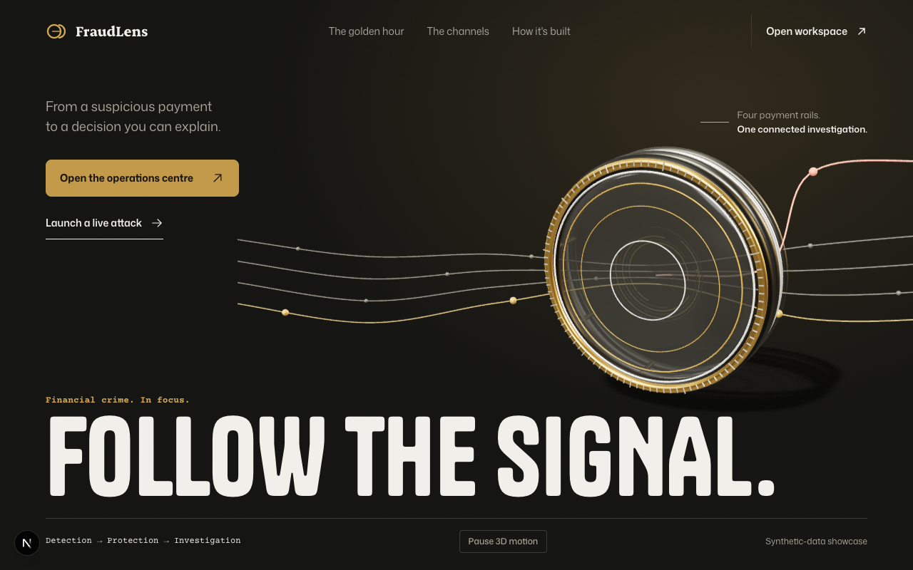
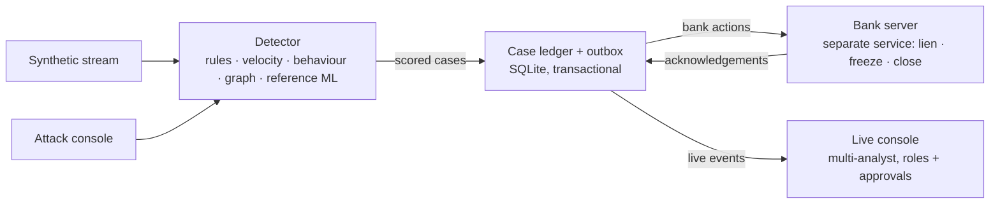

# FraudLens

A real-time, multi-analyst fraud operations centre for an Indian bank — UPI, net banking, cards and ATMs — with an enforcing bank simulator, a 1930 "golden hour" fund trace and an AI agent that triages but never decides.



## Why it matters

When a scam victim in India calls the **1930** helpline or reports on the **National Cyber Crime Reporting Portal** (cybercrime.gov.in), the I4C's Citizen Financial Cyber Fraud Reporting and Management System exists to "stop siphoning off funds by the fraudsters" ([PIB, Ministry of Home Affairs, 6 Aug 2024](https://www.pib.gov.in/PressReleasePage.aspx?PRID=2042130)). Mule accounts move the money on within minutes, so the bank's job is to trace each hop and hold what is left, fast. Banks also carry customer-protection duties for unauthorised electronic transactions ([RBI circular, 6 Jul 2017](https://www.rbi.org.in/scripts/BS_CircularIndexDisplay.aspx?Id=11040)); FraudLens therefore never freezes the victim's own account. What each source does and does not say is mapped in [docs/GUIDANCE.md](docs/GUIDANCE.md).

## Try it

**Live demo:** https://fraud-lens-r3t0.onrender.com — sign in with a demo role on a laptop (a second browser or private window gives you a second role) and launch a scam from [/attack](https://fraud-lens-r3t0.onrender.com/attack) on your phone. It runs on Render's free tier, so after 15 idle minutes it sleeps and the first visit takes about a minute to wake (52 s measured). Demo data resets when the server restarts.

Locally (Python 3.12, Node.js 24+):

```bash
python3.12 -m venv .venv
.venv/bin/python -m pip install -r requirements.lock
npm --prefix frontend ci
.venv/bin/python scripts/dev.py
```

Open http://127.0.0.1:3000 (bank simulator :8002, API :8001). The login page has one-click demo roles. Open two windows with different roles — for example `127.0.0.1:3000` and `localhost:3000`, which keep separate sessions — and launch an attack from http://127.0.0.1:3000/attack to watch the hand-off.

| Demo role | Username | Can do |
| --- | --- | --- |
| L1 Analyst | `kmehta`, `pnair` | Claim, investigate, escalate, place liens; request approval for the rest |
| L2 Senior Analyst | `riyer` | Freeze debits, release liens, confirm fraud or clear false positives, assign, approve L1 requests |
| Fraud Supervisor | `asharma` | Close traced mule accounts after confirmed fraud, record the NCRP report, set agent policy |

All demo accounts use the password `fraudlens123`. Fictional data only — never enter real account or card details.

Single container (the image the live demo runs on Render): `docker build -t fraudlens . && docker run -p 7860:7860 fraudlens`, then open http://localhost:7860.

## What it does

- **Multi-analyst roles and approvals.** L1 → L2 → Supervisor permission table enforced by the API (403 with the required role). Lower roles request approval; a different, senior analyst approves or rejects. Case claiming uses optimistic versions, so two analysts cannot both win (409). Presence shows who is online and on which case.
- **Enforcing bank ladder.** A separate bank service holds a specific amount (lien), freezes debits, or closes an account. Credits still post into liened accounts; payments into closed accounts are declined. Every request is shown as pending until the bank acknowledges it.
- **1930 golden-hour fund trace.** A complaint traces the reported payment FIFO through up to four hops in 24 hours, then liens what each mule account still holds — partially when money has already moved or been cashed out at an ATM.
- **Public attack console.** `/attack` lets anyone launch mule layering, SIM-swap takeover, card testing or an ATM cash-out burst against the simulated bank and watch six live steps, then report it to 1930 as the victim.
- **FraudLens Agent.** Prioritises cases, drafts a brief and an NCRP narrative (masked account references, IST), auto-assigns to online L1s when a supervisor enables it, and places golden-hour liens. It never confirms fraud, releases funds or closes accounts; every agent action is an audited event. Optional local LLM wording is rejected if it changes any rupee amount.
- **Reports and audit.** JSON, Markdown and PDF case reports (with the fund trail); one audit ledger behind every screen.

## Architecture



## Structure

```text
fraudlens/
  api/             FastAPI app: auth, the /ops router, public attack routes, client IP and limits
  operations/      the operations service, split by concern (ingest, decisions, approvals,
                   complaints, delivery, snapshot, simulation), detector + rules, agent, trace, store
  bank_simulator/  the separate simulated bank: ledger and routes
  core/            analyst accounts and roles, scoring agents, shared rate limiter
  data/            synthetic training data for the reference ML model
  evaluation/      the controlled detector evaluation
frontend/          Next.js console, landing and /attack (see frontend/README.md)
tests/             backend unittest suite
scripts/           dev.py (local launcher), serve.py (container entry point), checks, HF upload
deploy/            deployment notes; Render is live, the Hugging Face Space is optional
docs/              architecture, API, guidance, evaluation, verification record (see docs/README.md)
Dockerfile         the single-container image the live demo runs
DESIGN.md          design system · PRODUCT.md product intent · AGENTS.md notes for coding agents
```

## Evaluation

Controlled synthetic corpus of 376 terminal payment attempts (eight seeds, four channels), from [docs/verification/operations-evaluation.json](docs/verification/operations-evaluation.json):

| Decision threshold | TP | FP | TN | FN | Precision | Recall |
| --- | ---: | ---: | ---: | ---: | ---: | ---: |
| Review, score ≥0.5 | 184 | 64 | 96 | 32 | 0.7419 | 0.8519 |
| Automatic protection, score ≥0.8 | 176 | 32 | 128 | 40 | 0.8462 | 0.8148 |

The corpus deliberately includes authorised-but-unusual payments (false positives) and fraud that looks ordinary (false negatives). It is not real fraud prevalence; see [docs/OPERATIONS_EVALUATION.md](docs/OPERATIONS_EVALUATION.md).

The gradient-boosted classifier on its own, scored on 10,399 transactions from synthetic seeds it never trained on: precision 0.9492, recall 0.8788, ROC-AUC 0.9463 (`python -m fraudlens.evaluation.classifier`; same generator for training and test, so not a real-world figure).

## Engineering notes

- **Transactional outbox.** Payments, cases, bank jobs and audit events commit in one SQLite transaction; a worker delivers bank actions afterwards, so a crash never loses or duplicates an action.
- **Idempotency.** Transactions, bank actions and complaints are keyed by ID; an identical retry is a no-op, a different payload under the same ID is a 409.
- **Optimistic versions.** Every case write checks `expected_version`; stale claims and decisions get 409 with the current owner.
- **Reconciliation.** Timeouts after the bank committed are reconciled against the bank's own record on retry, and requests are never shown as confirmed until acknowledged.
- **Money** is integer paise end to end, displayed with ₹ and Indian grouping.

<details>
<summary>Limits</summary>

- Synthetic data and a simulated bank only. No real bank, NPCI, I4C or police connection; nothing is reported externally.
- Detection rules were written alongside the fixtures they are evaluated on; results do not show real-world accuracy.
- Regulatory mapping is paraphrased and partial; the NPCI lien entry is "modelled on (unverified)". Not legal advice or certification.
- One API worker, SQLite, in-process rate limits: a demo, not a production deployment.
- Five high-severity development-only npm advisory paths remain through the Next ESLint plugin (`braces`, GHSA-vfj7-8cjw-p6xm); production dependencies audit clean.

</details>

## Verify

```bash
.venv/bin/python -m unittest discover -s tests     # 241 tests
npm --prefix frontend run test                      # 64 tests
npm --prefix frontend run lint
(cd frontend && npx tsc --noEmit)
.venv/bin/python -m pip install -r requirements-dev.txt && .venv/bin/ruff check fraudlens scripts tests
npm --prefix frontend run format:check
.venv/bin/python -m fraudlens.evaluation.operations
```

Results and what was checked by hand are in [docs/VERIFICATION.md](docs/VERIFICATION.md).

## Credits

Built by [@aahil62](https://github.com/aahil62). FraudLens started as a hackathon project; this version — roles and approvals, the bank ladder, the 1930 fund trace, the attack console, the agent and the console redesign — is a solo rebuild. The original hackathon pipeline is preserved at the `legacy-hackathon` git tag.
