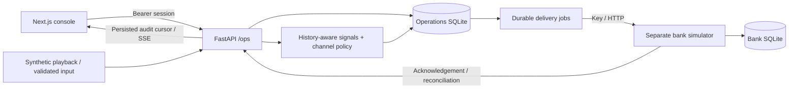

# Operational architecture

## Payments and protection

Unique input IDs and canonical fingerprints enforce idempotency. Scoring receives previously observed events at or before the current timestamp, bounded to the latest 1,000 by event time. Ground-truth labels never enter inference. Serialized ingestion prevents concurrent requests from observing inconsistent histories.

Review score 0.5 opens a case; protective score 0.8 queues an account or instrument restriction. These are versioned showcase choices, not NPCI-prescribed limits. Attempts, cases, audit events and delivery jobs commit before bank calls.

Actions are delivered before payments. A case's payment cannot overtake unresolved protection. Stable action/payment IDs support retries and reconciliation after crash or uncertain acknowledgement. Failed requests back off; uncertainty remains pending until reconciled.

## Analyst decisions

Case status, verdict and bank-action state remain separate. Optimistic versions reject stale updates. Final verdicts require a rationale and record the authenticated actor.

A false positive supersedes retryable restriction jobs and requests case-owned release, including uncertain earlier delivery. Contradictory verdicts are blocked while release completes. Resolved fraud can be reversed to a false positive. One release never clears another case's restriction.

## Shared state and recovery

SQLite WAL and explicit transactions provide durable state. Counts and recent display windows are read in one transaction; overall counts include the whole database rather than only 200 displayed rows. Channel totals derive from the same records.

Authenticated fetch streaming publishes a monotonically increasing persisted audit cursor. The shared client rejects older snapshots and recovers after reconnect/focus. A 10-second reconciliation poll backs up the stream. Reports explicitly describe an as-of snapshot.

One API worker is supported. Application locking coordinates ingestion, decisions and delivery; production multi-worker leases, horizontal scale and bank-specific adapters require additional work.

## Separate bank ledger

The bank is a different process/database. It posts allowed payments once, durably declines restricted/insufficient-funds attempts, and owns per-case restrictions. Test modes reject requests or lose an acknowledgement after committing an action. Health identifies the service as simulated; banking endpoints require a key.

This does not implement genuine payment authentication, network authorization, credit-card settlement, KYC, statutory reporting or actual account freezes.
